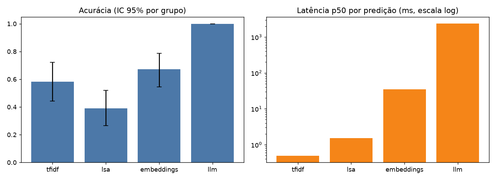

# benchmark-de-intencao

[](https://github.com/Rafael-Pedra-7325/benchmark-de-intencao/actions/workflows/ci.yml)
[](https://colab.research.google.com/github/Rafael-Pedra-7325/benchmark-de-intencao/blob/main/notebooks/executar_no_colab.ipynb)

Benchmark de **classificação de intenções de atendimento** (domínio: delivery de comida) que compara
três famílias de abordagem na mesma base, com o mesmo split e as mesmas métricas:

| Abordagem | O que é |
|---|---|
| **TF-IDF + Regressão Logística** | baseline clássico de ML, com busca de hiperparâmetros validada por grupo |
| **Embeddings + Regressão Logística** | encoder multilíngue pré-treinado (`sentence-transformers`) congelado + LR |
| **LLM zero-shot** | o modelo recebe a lista de intenções e classifica via API (Groq), sem nenhum treino |
| *LSA + LR (extra)* | representação densa 100% local (TF-IDF → SVD), usada como "embedding" offline |

A pergunta que o projeto responde: **quanto você ganha em acurácia ao trocar um modelo barato e rápido
por um caro e lento — e a que preço de latência e dinheiro?**

## Resultados

Números gerados por `python -m benchmark_intencao --max-teste 110 --preco-entrada 0.075 --preco-saida 0.30`;
relatório detalhado e matrizes de confusão em [`resultados/relatorio.md`](resultados/relatorio.md).

| Modelo | Acurácia (IC 95%) | F1-macro | Latência p50 (ms) | Custo / 1k pred. (USD) |
|---|---|---|---|---|
| TF-IDF + Regressão Logística | 0.582 (0.443–0.721) | 0.576 | 0.49 | 0 (local) |
| LSA (TF-IDF + SVD) + Regressão Logística | 0.391 (0.265–0.520) | 0.366 | 1.51 | 0 (local) |
| Embeddings (`paraphrase-multilingual-MiniLM-L12-v2`) + LR | 0.673 (0.545–0.787) | 0.676 | 34.95 | 0 (local) |
| LLM zero-shot (`openai/gpt-oss-20b`) | 1.000 (1.000–1.000) | 1.000 | 2394.31 | 0.0404 |



> **Como ler:** a acurácia baixa dos modelos clássicos é esperada neste setup. O treino tem poucas
> frases-base por intenção (9) e o teste só usa frases-base **nunca vistas**; é um teste de
> generalização/paráfrase, não de memorização. O IC é largo porque o teste tem 44 frases-base
> independentes. Latência depende da máquina.

## Como rodar

### 1. Local (Python 3.9+)

```bash
git clone [https://github.com/Rafael-Pedra-7325/benchmark-de-intencao.git](https://github.com/Rafael-Pedra-7325/benchmark-de-intencao.git)
cd benchmark-de-intencao
python -m venv .venv && source .venv/bin/activate      # Windows: .venv\Scripts\activate
pip install -e ".[todos]"                               # núcleo + embeddings + LLM

export GROQ_API_KEY="sua-chave"                        # Windows (PowerShell): $env:GROQ_API_KEY="sua-chave"
python -m benchmark_intencao                            # roda os 4 modelos
```

Sem a chave (ou sem o pacote/modelo), o modelo correspondente é **pulado com aviso** e o resto roda.
Use `--estrito` se quiser que isso vire erro.

Só o que roda offline, sem rede:

```bash
pip install -e .
python -m benchmark_intencao --modelos tfidf lsa
```

### 2. Google Colab

Clique no badge "Abrir no Colab" acima. Crie uma chave gratuita no [Groq Console](https://console.groq.com/) e salve em *Secrets* como `GROQ_API_KEY`.

### 3. CI (GitHub Actions)

O workflow em `.github/workflows/ci.yml` roda os testes e o benchmark offline a cada push e publica o
relatório como artefato. Ele **não** baixa modelos nem chama a API (sem custo, sem segredos).

## Opções úteis

```bash
# Amostra estratificada de ~110 linhas de teste (mais rápido e evita limite de RPM no plano gratuito)
python -m benchmark_intencao --max-teste 110

# Simula o custo em produção (USD por milhão de tokens — confira a tabela de preços da Groq)
python -m benchmark_intencao --preco-entrada <X> --preco-saida <Y>

# Outro modelo de LLM (ex.: openai/gpt-oss-120b) / de embeddings
python -m benchmark_intencao --llm-modelo openai/gpt-oss-120b --modelo-embeddings paraphrase-multilingual-MiniLM-L12-v2

# Seus próprios dados
python -m benchmark_intencao --dados meu_dataset.csv
```

Os preços **não estão fixos no código** de propósito: mudam com o tempo (e o plano gratuito da Groq tem cota sem cobrança). Sem `--preco-*`, o custo do LLM aparece como `n/d`
(os tokens consumidos ainda são reportados).

## Decisões de método

- **Split por grupo, sem vazamento.** Cada frase-semente gera ~10 variações. Treino e teste não compartilham
  frase-base (há um teste automatizado para isso). Um split aleatório por linha inflaria a acurácia de TF-IDF.
- **Hiperparâmetros com `GroupKFold`** no treino (analisador de palavra vs. caractere, n-gramas, `C`).
- **IC por bootstrap de clusters:** reamostra frases-base, não linhas, porque as variações são quase duplicatas.
- **Latência = uma predição por vez** (batch=1), igual para todos, simulando uso online. Há aquecimento
  descartável nos modelos locais.
- **Custo do LLM** vem dos tokens reais devolvidos pela API, não de estimativa.
- **Respostas inválidas do LLM** (fora da lista de intenções) contam como erro e são contabilizadas.
- **Falha isolada:** se um modelo falhar, o benchmark continua e o motivo vai para o relatório.

## Dados

O dataset padrão em [`data/intencoes.csv`](data/intencoes.csv) é **sintético**: 143 frases-semente escritas à mão
([`catalogo.py`](benchmark_intencao/catalogo.py)), 11 intenções, expandidas com saudações, números de pedido,
abreviações ("vc", "pq"), typos e remoção de acentos. Para regenerar: `python -m benchmark_intencao.dados`.

Isso é uma limitação: **não é tráfego real de clientes**, então os números absolutos não devem ser
extrapolados para produção. O valor do projeto está no método e na comparação entre abordagens.
Para dados reais, passe um CSV com `texto,intencao` (e, se possível, `grupo` e `particao` para evitar vazamento).

## Estrutura

```
benchmark_intencao/
  catalogo.py    intenções, descrições e frases-semente
  dados.py       gerador sintético, carregamento, split por grupo
  modelos.py     TF-IDF+LR, LSA+LR, embeddings+LR, LLM zero-shot
  benchmark.py   treino, predição amostra-a-amostra, latência, tokens/custo
  metricas.py    acurácia, F1, IC por clusters, confusões, custo
  relatorio.py   metricas.csv, predicoes.csv, relatorio.md, gráficos
  cli.py         python -m benchmark_intencao
tests/           18 testes (sem rede, sem API)
resultados/      saída da última rodada commitada
```

## Testes

```bash
pip install -e ".[dev]" && pytest -q
```

O caminho do LLM é testado com um cliente falso (parsing da resposta, retry, contagem de tokens e custo),
então a suíte nunca consome cota nem precisa de rede.

## Adicionando um modelo

Herde de `Classificador` em `modelos.py` (`treinar`, `prever`, opcionalmente `preparar`), registre a chave em
`criar()` e em `config.MODELOS_DISPONIVEIS`.

## Licença

MIT.
