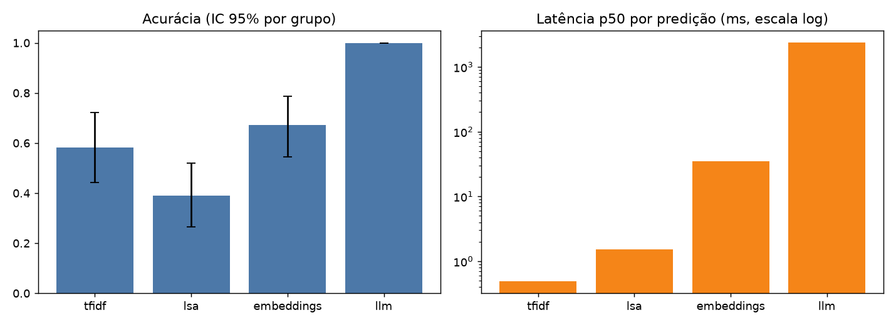

# Relatório do benchmark de intenções

Gerado em 2026-11-17 03:23 · Python 3.14.6 · scikit-learn 1.9.1 · Windows AMD64

## Dados

- Treino: **990** linhas (99 frases-base)
- Teste: **110** linhas (44 frases-base, nunca vistas no treino)
- Intenções: **11**
- Fonte: `data\intencoes.csv`
- ⚠️ Com o dataset sintético padrão, o número efetivo de exemplos de teste independentes é o de frases-base (não o de linhas). Por isso os intervalos de confiança são calculados por grupo e tendem a ser largos.

## Resultados

| Modelo | Acurácia (IC 95%) | F1-macro | Latência p50 (ms) | p95 (ms) | Custo / 1k pred. (USD) | Treino (s) |
|---|---|---|---|---|---|---|
| TF-IDF + Regressão Logística | 0.582 (0.443–0.721) | 0.576 | 0.49 | 0.99 | 0 (local) | 3.97 |
| LSA (TF-IDF + SVD) + Regressão Logística | 0.391 (0.265–0.520) | 0.366 | 1.51 | 3.42 | 0 (local) | 0.21 |
| Embeddings (sentence-transformers) + Regressão Logística | 0.673 (0.545–0.787) | 0.676 | 34.95 | 42.61 | 0 (local) | 11.89 |
| LLM zero-shot (openai/gpt-oss-20b) | 1.000 (1.000–1.000) | 1.000 | 2394.31 | 3652.45 | 0.0404 | 0.00 |

## Notas de leitura

- **Latência**: tempo de UMA predição isolada (batch=1), na máquina que rodou o benchmark. Para o LLM inclui rede e fila da API; para modelos locais, só inferência.
- **Custo**: modelos locais mostram 0 porque não têm custo por chamada — custo de infraestrutura e de treino não está incluído. Para o LLM, o custo vem dos tokens reais reportados pela API × os preços informados em `--preco-entrada/--preco-saida` (USD por milhão de tokens); sem os preços, aparece `n/d`.
- **Zero-shot** não usa o conjunto de treino. Respostas fora da lista de intenções contam como erro (`invalido`).

## Configurações e erros mais comuns

### TF-IDF + Regressão Logística

Baseline clássico: n-gramas de palavra ou caractere + LR, com busca de hiperparâmetros (GroupKFold).

- melhor config: analyzer=char_wb, ngram=(2, 4), C=10 (F1-macro CV por grupo = 0.528)
- confusões mais frequentes (real → previsto):
  - `atraso_entrega` → `status_pedido`: 5
  - `alterar_pedido` → `item_faltando_ou_errado`: 4
  - `falar_com_humano` → `problema_conta`: 4
  - `cancelar_pedido` → `atraso_entrega`: 3
  - `cupom_promocao` → `problema_conta`: 3

### LSA (TF-IDF + SVD) + Regressão Logística

Representação densa local (Análise Semântica Latente), sem baixar modelo. Serve de 'embedding' offline quando sentence-transformers não está disponível.

- 100 componentes SVD, C=10
- confusões mais frequentes (real → previsto):
  - `atraso_entrega` → `status_pedido`: 6
  - `alterar_pedido` → `item_faltando_ou_errado`: 6
  - `atraso_entrega` → `reembolso`: 3
  - `item_faltando_ou_errado` → `qualidade_comida`: 3
  - `reembolso` → `falar_com_humano`: 3

### Embeddings (sentence-transformers) + Regressão Logística

Encoder multilíngue pré-treinado congelado + LR treinada sobre os vetores.

- encoder=paraphrase-multilingual-MiniLM-L12-v2, C=10
- confusões mais frequentes (real → previsto):
  - `qualidade_comida` → `item_faltando_ou_errado`: 4
  - `alterar_pedido` → `item_faltando_ou_errado`: 3
  - `status_pedido` → `item_faltando_ou_errado`: 2
  - `status_pedido` → `atraso_entrega`: 2
  - `atraso_entrega` → `status_pedido`: 2

### LLM zero-shot (openai/gpt-oss-20b)

Sem treino: o modelo recebe a lista de intenções e classifica cada mensagem via API (Groq).

- modelo=openai/gpt-oss-20b, max_tokens=256, temperature=0, sem exemplos (zero-shot)
- tokens: 45330 entrada / 3466 saída
- nenhuma confusão no conjunto de teste
