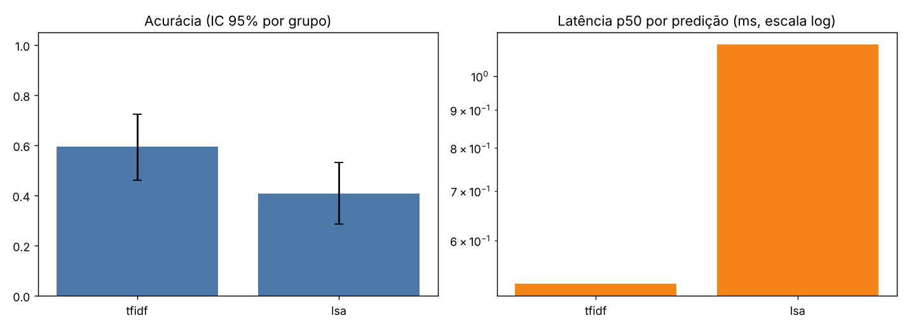

# Relatório do benchmark de intenções

Gerado em 2026-11-17 00:26 · Python 3.12.3 · scikit-learn 1.9.1 · Linux x86_64

## Dados

- Treino: **990** linhas (99 frases-base)
- Teste: **440** linhas (44 frases-base, nunca vistas no treino)
- Intenções: **11**
- Fonte: `data/intencoes.csv`
- ⚠️ Com o dataset sintético padrão, o número efetivo de exemplos de teste independentes é o de frases-base (não o de linhas). Por isso os intervalos de confiança são calculados por grupo e tendem a ser largos.

## Resultados

| Modelo | Acurácia (IC 95%) | F1-macro | Latência p50 (ms) | p95 (ms) | Custo / 1k pred. (USD) | Treino (s) |
|---|---|---|---|---|---|---|
| TF-IDF + Regressão Logística | 0.595 (0.461–0.725) | 0.588 | 0.52 | 0.60 | 0 (local) | 3.13 |
| LSA (TF-IDF + SVD) + Regressão Logística | 0.407 (0.286–0.532) | 0.384 | 1.10 | 1.17 | 0 (local) | 0.10 |

## Notas de leitura

- **Latência**: tempo de UMA predição isolada (batch=1), na máquina que rodou o benchmark. Para o LLM inclui rede e fila da API; para modelos locais, só inferência.
- **Custo**: modelos locais mostram 0 porque não têm custo por chamada — custo de infraestrutura e de treino não está incluído. Para o LLM, o custo vem dos tokens reais reportados pela API × os preços informados em `--preco-entrada/--preco-saida` (USD por milhão de tokens); sem os preços, aparece `n/d`.
- **Zero-shot** não usa o conjunto de treino. Respostas fora da lista de intenções contam como erro (`invalido`).

## Configurações e erros mais comuns

### TF-IDF + Regressão Logística

Baseline clássico: n-gramas de palavra ou caractere + LR, com busca de hiperparâmetros (GroupKFold).

- melhor config: analyzer=char_wb, ngram=(2, 4), C=10 (F1-macro CV por grupo = 0.528)
- confusões mais frequentes (real → previsto):
  - `atraso_entrega` → `status_pedido`: 17
  - `falar_com_humano` → `problema_conta`: 15
  - `qualidade_comida` → `item_faltando_ou_errado`: 13
  - `alterar_pedido` → `item_faltando_ou_errado`: 12
  - `status_pedido` → `problema_conta`: 10

### LSA (TF-IDF + SVD) + Regressão Logística

Representação densa local (Análise Semântica Latente), sem baixar modelo. Serve de 'embedding' offline quando sentence-transformers não está disponível.

- 100 componentes SVD, C=10
- confusões mais frequentes (real → previsto):
  - `atraso_entrega` → `status_pedido`: 19
  - `alterar_pedido` → `item_faltando_ou_errado`: 19
  - `cupom_promocao` → `cancelar_pedido`: 13
  - `atraso_entrega` → `reembolso`: 12
  - `cupom_promocao` → `falar_com_humano`: 12
